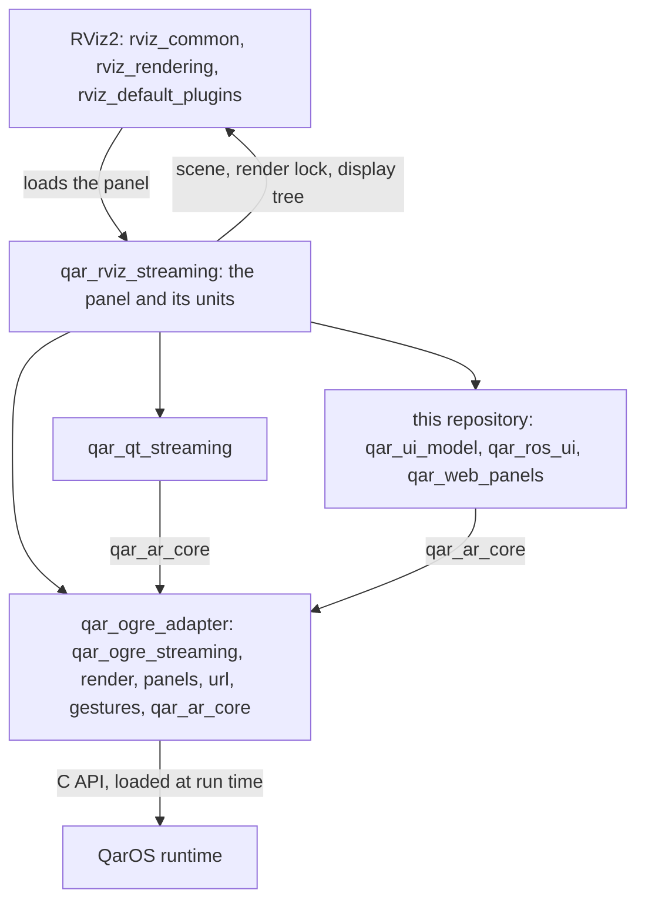
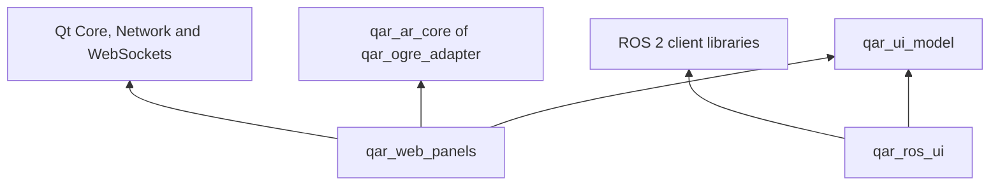
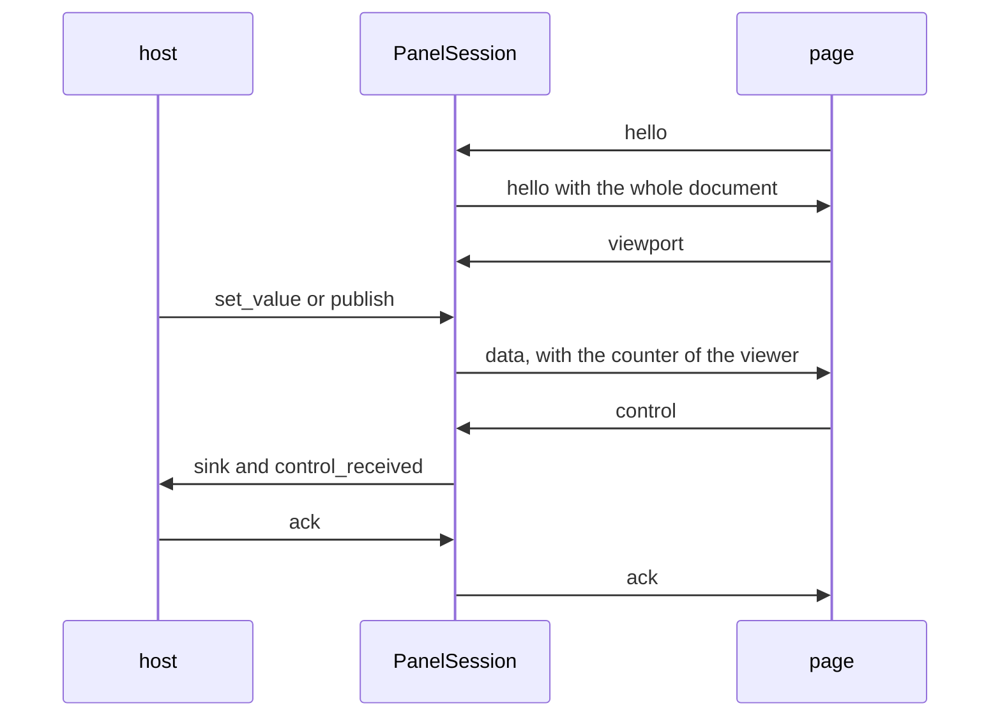

# Architecture

This page explains how the plugin and its three web libraries are built: what they take from the other two repositories and from RViz, which parts they have, which thread runs what, how each of its pipelines works, and why a few parts are the way they are. [API](API.md) lists the interfaces that the plugin publishes and uses, [Configuration](CONFIGURATION.md) lists the settings, and [Operator guide](OPERATOR_GUIDE.md) describes the controls of the panel.

## How the plugin uses the libraries

The plugin is one ament package, `qar_rviz_streaming`, and its one shared library holds the panel and a set of small units. It has no machinery of its own for 3D rendering, GUI panels, web pages or ROS graphs: the libraries of the other repositories and the three web libraries of this repository join in the panel and nowhere else; the package finds the first as installed CMake packages or, in a developer build, as source checkouts, and builds the web libraries from the tree of this repository. The table lists the components that it links.

| Repository | Components | What the plugin uses them for |
|---|---|---|
| qar_ogre_adapter | `qar_ar_core`, `qar_ogre_streaming`, `render`, `panels`, `url`, `gestures` | rendering the scene of RViz from the head pose of each peer, the session of QarOS, the senders and the input source of GUI panels, the panels that show a URL, the gestures of the app volume, and the seams and the pick model |
| qar_qt_streaming | `qar_qt_streaming` | streaming a Qt widget as a GUI panel: the manager of the panels, the video panel widget and the window that is shown off-screen |
| this repository | `qar_ui_model`, `qar_ros_ui`, `qar_web_panels` | the model of a page, graph discovery and the bridges for topics, services and actions, and the server that delivers the pages |



The dependencies point one way. The plugin depends on `qar_ogre_streaming`, which depends on the QarOS C API and on Ogre; the plugin may include the headers of RViz, Qt and ament, and `qar_ogre_streaming` may not. `qar_qt_streaming` and `qar_web_panels` depend on `qar_ar_core` of qar_ogre_adapter, for the seams of the panels and the C types of QarOS. Nothing links an import library of the SDK, because qar_ogre_adapter loads `qar-streaming-c.dll` at run time ([Rebuilding after an SDK update](SDK_COMPATIBILITY.md#rebuilding-after-an-sdk-update)). The panel is the one place where the libraries meet. It hands the scene of RViz to `qar_ogre_streaming`, the widget of a streamed window to the manager of `qar_qt_streaming` and the model of a page to the server of `qar_web_panels`, and everything that reaches QarOS goes through the one session that the render factory of qar_ogre_adapter owns: the senders and the input source of the panels and the factory of the URL panels borrow it.

## RViz integration points

RViz2 is a Qt application whose extensions are plugins, and the plugin touches it in the places of the table. All of them are installed interfaces of the distribution, except the display factory and the Displays panel, which the plugin has to reach around. [Background: RViz2 for QarOS engineers](#background-rviz2-for-qaros-engineers) explains the terms.

| Point | What the plugin does |
|---|---|
| Panel class | `QarStreamingPanel` derives from `rviz_common::Panel`, a Qt widget. It is exported with the macro of pluginlib and registered by `plugin_description.xml` under the class identifier `qar_rviz_streaming/QarStreamingPanel`. RViz calls `onInitialize()` when the display context is available, and the panel creates the library wiring there. |
| Display context | `RVizDisplayContextAdapter` wraps `getDisplayContext()` and gives the library the shared Ogre scene manager, the camera of the current view, the calls of the render lock and a few numbers for the diagnostics. No header of RViz reaches the libraries. |
| Render lock | `RVizRenderLock` forwards `lockRender()` and `unlockRender()`. The scheduler takes the lock once for a whole batch of peers, so that every peer renders the same state of the scene, and the panel calls `queueRender()` after a batch that rendered; RViz coalesces such calls, and any thread may make them. |
| Render thread | `RVizRenderThreadExecutor` stands for the Qt GUI thread: it posts work to the application object as a queued call, and `is_render_thread()` compares the calling thread with the one that it captured when it was made. |
| ROS node | The node of RViz comes from `getRosNodeAbstraction()`. RViz spins it on the GUI thread, so that the callbacks of the bridges and of the geolocation subscription run there. The plugin keeps a callback group of its own on that node, a mutually exclusive group that the executor of RViz spins with the node, and the geolocation subscription and every entity that the bridges create there join it. When the panel is destroyed it releases those entities and then the group, while the plugin library is still loaded: RViz frees the library before it destroys its node, and the references that a group of that node holds to its entities are released through code of the library. The video does not use it: it has a private context ([Video pipeline](#video-pipeline)). |
| Display tree | The plugin reads it through `getRootDisplayGroup()`: it finds the Grid displays for the floor plane, finds the Image and Camera displays for the video regions and the health field, and creates a display for a topic that the Add dialog picked. The header of the display factory is not installed, so the catalog of display classes is rebuilt from the plugin manifests that pluginlib knows. |
| Docks | The panels that can be streamed are the `QDockWidget` children of the main window, and the signal `closed()` of `rviz_common::PanelDockWidget` closes the AR panel of a dock that is closed. |
| Displays panel | A second instance of the Displays panel of RViz is made through the panel factory of the main window ([The hidden Displays panel](#the-hidden-displays-panel)). |
| Qt keywords | The plugin is compiled with `QT_NO_KEYWORDS` except for one source, and it removes the macro `interface` of the Windows headers ([Qt keyword and header pitfalls](DEVELOPING.md#qt-keyword-and-header-pitfalls)). |

RViz has no call that renders a camera into a texture, and the plugin does not ask for one: `qar_ogre_streaming` creates the eye cameras of each peer in the scene manager that RViz owns, and it renders them into textures of its own inside the render lock. What a peer sees is therefore the scene that the displays of RViz have updated, at the state of the batch, and nothing is read back from the window of RViz.

## Components

The units of the plugin are small, and the rules that have edge cases live in the ones that need neither RViz nor Qt widgets, so that the plain-CMake test project of the repository compiles and tests them. The panel and the units that touch RViz, rclcpp or Ogre build only under colcon.

| Unit | What it does | Tested without RViz |
|---|---|---|
| `qar_streaming_panel.cpp` | the panel: widgets, session, and every pipeline below | no |
| `rviz_display_context_adapter.cpp`, `rviz_render_lock.hpp` and `rviz_render_thread_executor.cpp` | the seam to RViz: display context, render lock and GUI thread | no |
| `rviz_peer_panel_model.cpp` and `mock_sender_factory.hpp` | the list of simulated peers and the factory of simulated senders for the offline preview | no |
| `qar_offscreen_capture.cpp` | the PNG writers, the statistics of a capture and the measure of stereo parallax for the capture buttons and the scripted modes; it uses the vendored `stb_image_write.h` | no |
| `hidden_rviz_panel.cpp` and `rtti_guard.hpp` | the second Displays panel and the type check in front of the factory of RViz | the guard only |
| `panel_display_names.hpp` | the title under which a new QarOS panel is created: the title that was asked for at the first start and a numbered title at every later start | yes |
| `grid_floor_plane.cpp` and `grid_floor_plane_geometry.cpp` | the floor plane under every Grid display, and the pure math of its placement | the geometry only |
| `windows_scheduling.cpp` | the opt-out of Windows power throttling and the timer resolution | yes |
| `ros_image_frame_source.cpp`, `video_source_executor.cpp` and `image_topic_transport.cpp` | the video: subscription, decode and the private ROS context; and the choice between the raw and the compressed type | the type choice only |
| `display_class_catalog.cpp`, `ros_topic_tree.cpp`, `ros_graph_tree.cpp` and `add_topic_dialog.cpp` | the Add dialog: the tree of topics, services and actions, the catalog of display classes, and the dialog | all but the dialog |
| `ar_ros_entity.cpp`, `ar_panel_generator.cpp`, `ar_semantic_templates.cpp`, `ar_control_router.cpp` and `ar_exposure_registry.cpp` | the AR tools: what is exposed, the model of its page, the 17 semantic layouts, the meaning of a control event, and the list of what is exposed | yes |
| `spatial_interaction.cpp` and `spatial_publish.cpp` | the armed mode and its pick sessions, and the ROS message that a pick becomes | yes |
| `panel_settings.cpp` | the twelve settings that the panel keeps in the RViz configuration, and the rule that an acceptable variable wins over the saved value and that over the default | yes |
| `panel_ground_rule.cpp` | the height of the AR panels above the RViz ground, the two ways to hang the panels with a fixed place, the frame of the AR panels, the size of the app volume and the brightness field of the heartbeat | yes |
| `ar_control_panel_model.cpp`, `ar_control_panel_router.cpp`, `ar_control_panel_state.cpp` and `ar_control_panel_placement.cpp` | the AR control panel: the model of its page, the validation of its commands, the patches of its state, and its place for each peer | yes |
| `stable_panel_layout.cpp` | the tabbed layout of the panel: scroll pages, the shortened status lines, the constant size hints, the fit of a dock and the readout box | offscreen, with Qt Widgets and no RViz |

The units that are pure compile into the test target `qar_rviz_streaming_tests` and the colcon build compiles every unit, so the colcon build is the only one that proves that the panel compiles ([Build gates](DEVELOPING.md#build-gates)).

## The render tick

Everything that the panel does repeatedly runs in one handler of one timer on the Qt GUI thread, `onRenderTick()`. The timer is a `QTimer` of the type `Qt::PreciseTimer`, and its period is 0.1 ms unless `QAR_PANEL_TICK_MS` gives another one. One call of the handler does these things in this order:

1. It counts the tick and the gap since the previous tick, and writes the heartbeat when the period has elapsed. The counting comes first, before every early return, so that the heartbeat records that the timer is served even when there is nothing to render.
2. It posts one pump of the AR input as an event ([Design notes](#the-render-tick-is-a-timer-a-nested-event-loop-must-never-be-entered-from-its-handler) says why it is posted).
3. It runs the AR panels, the AR tools, the spatial picks and the floor plane, which need no peer and no 3D stream, so that an idle stream does not stop them.
4. In the live mode it adopts a finished connect, and while connected it applies a pending geolocation fix and drives the 3D streams: it latches the GL context, opens a stream for each peer that asked for one, renders and submits the batch under the render lock, and closes the streams that the runtime closed. In the preview it renders the batch of simulated peers.


A QTimer cannot have a period below 1 ms, so the period 0.1 ms is a timer without an interval, which Qt fires whenever the event loop is idle, and the handler runs its body at most once for each 100 microseconds: a call that is held back costs one clock read and one comparison. The type is always `Qt::PreciseTimer`, because Qt would otherwise use a coarse timer that Windows serves from its system tick of about 15.6 ms, which turns even 16 ms into about 31 ms. Applying a period stops the timer, sets it again, resets the throttle and starts it, so that a stale last-run time cannot hold the new period back. The tick does not pace a stream: the scheduler paces each peer by its own frame budget, however often the timer fires, and the switch `"Prime next frame"` is a live A/B switch for telling a wait that the tick causes apart from a mismatch between the pose and the frame of the SDK.

"Prime next frame" decides where the wait for the next frame of QarOS starts. When it is on, which is the default, the wait starts right after a frame has been shown, so that one tick serves one frame; when it is off, the wait starts at the next tick, so that two ticks serve one frame. The heartbeat ends with the tick period and the prime switch, and with `rr=` while the frame trace is on, in that order, so that a parser of the earlier fields is not disturbed; the source of the period in the line is the field of the panel and not the interval of the timer, which is 0 in the zero-interval mode.

## Live connect

The panel connects to QarOS when you press `"Connect to QarOS"` and never when it loads. Connecting in `onInitialize()` would run the whole handshake of the zenoh transport and the peers on the GUI thread before the event loop of Qt is live, so that the asynchronous coordination of the runtime could never progress. `QAR_PANEL_LIVE_STREAM` makes the panel live-capable and does not connect it.

The session is built on a worker thread, because building it is a straight line of blocking SDK calls and the SDK offers no asynchronous form of them. In a connect that the authors of qar_rviz_plugin recorded, the build took about 2.9 s, about 2.1 s of it in `qar_runtime_create_session`, which starts the launcher of the runtime and waits for it, and about 0.7 s in `qar_session_join`, so that nothing was worth moving into the construction of the panel. The hand-over is strictly sequential: the worker publishes the finished factory with a release store, the render tick sees it with an acquire load and adopts it, and from then on the GUI thread is the only thread that calls into the session, which is the single-threaded use per runtime that the conventions of the SDK ask for. The shared state of the connect is a `shared_ptr`, so that the writes of the worker stay valid while the panel is destroyed.

Adopting the session does these things on the GUI thread, in this order: it gives the factory to the manager, switches the streaming on, subscribes to the gestures of the app volume, sets the state label and logs that the connection is open, and starts the hidden Displays panel. A failed connect reports its error and leaves no session behind, so that the next click builds one again. `"Disconnect (pause)"` does not close the session: it stops the streaming and keeps the session and its handles, which the destructor of the panel tears down in the right order, the manager and its streams before the factory and the session. The invitation of a peer and the calls that create, change or close a QarOS panel are synchronous on the GUI thread whatever the connect does ([Threading summary](#threading-summary)).

## Panels pipeline

The panels pipeline turns a Qt widget of RViz into a QarOS GUI panel and carries the clicks of the operator in AR back to the widget. The plugin owns little of it: it prepares the manager of qar_qt_streaming once the session is live, and the manager captures the widgets, creates the QarOS panels with their video senders, and delivers the input. The steps are these:

1. **Preparation.** `ensurePanelManager()` needs a live session and says so when there is none. It makes the input source of the panels from the session, the factory of the senders from the render factory and that source, and a `QtPanelStreamManager` that has the panel as the sink of its diagnostics, the close mode that `QAR_PANEL_CLOSE_MODE` selects, and the pump of the input in the tick switched off.
2. **Choosing.** The combo lists the panel itself, then the docks of the main window under the key `dock:<title>`, the open video panels under `video:<topic>`, and the copy of the Displays panel. `"Stream panel to AR"` places the widget and gives it to the manager, and the QarOS panel is created on the next tick and not on the click.
3. **Capturing.** Each tick, `tickArPanels()` shows the hidden panel again if something hid it, retires the streams whose widgets were destroyed, adopts the aspect of the video panels, calls `tick()` of the manager, which captures, submits and paces every panel by its own frame rate, and refreshes the readout at most every 0.25 s.
4. **Input.** QarOS delivers the gestures of a panel on a callback thread, and the input source only queues them. A pump that the render tick posts as an event drains the queue on the GUI thread and gives each gesture to the widget. The pump is posted and not called, because a click can open a dialog, and the nested event loop of the dialog would stop the timer of the tick ([Design notes](#the-render-tick-is-a-timer-a-nested-event-loop-must-never-be-entered-from-its-handler)).
5. **Closing.** Every end of a stream goes through `closeStreamedPanel()`, so that the close mode applies to each of them alike: the button `"Stop streaming"`, a dock that is closed, a widget that was destroyed, and the sweep of the manager for dialogs. With hiding on, which is the default, the close mode is `park`: the AR panel is hidden and kept with its video sender until the session ends. With hiding off, `destroy` closes the AR panel and destroys its video sender, and `notice` keeps the AR panel as a notice and the sender until the session ends.

The placement is fixed. The first panel that the operator streams hangs 1.5 m high and 1 m in front of the origin of the room, and each further panel steps 0.65 m along x. With `QAR_PANEL_FIXED_POSES` set to `ground`, the height of the top edge is counted from the RViz ground instead of the origin of the room. The hidden Displays panel hangs at x = -1.2 m, and an AR tool hangs 1.2 m in front and steps 0.7 m to the left. No call asks QarOS where the operator is looking. The pose of a viewer reaches a program only through a render sender, in the frame information of each frame, and it is in the app content space of the volume. The plugin has render senders and renders each peer from that pose, and it uses the pose only to place the AR control panel, so the placements of the other panels are constants, and a dialog that a streamed panel opens is not placed by the plugin at all: the manager gives it a panel of its own beside its owner.

The title of a QarOS panel is chosen once, right before the widget is given to the manager. `applyUniqueDisplayName()` asks one object of the process, `PanelDisplayNames`, for the title: the first start under a title keeps it, and each later start gets a number after it, so that the dock Views gets the titles Views, Views (2) and Views (3) at its first, second and third start. The panels of the list, the hidden Displays panel and the video panel of an image tool pass through it, and the key of the panel is not touched. A start that revives a retired panel, which is a parked panel or a panel that shows a notice, does not pass through it, because that start creates no QarOS panel. The numbering is a mitigation of unproven value and no prevention: the Visualizer crashed at each start of the hidden Displays panel after a stop that the authors of qar_rviz_plugin observed, with a numbered title as well as with the old one. It stays as a precaution of unproven value: the Visualizer that QarOS started again showed an empty or black scene in some of the restarts with a numbered title as well as with the old one, and the difference between the two was within chance ([The Visualizer crashes when the hidden Displays panel is started again](TROUBLESHOOTING.md#the-visualizer-crashes-when-the-hidden-displays-panel-is-started-again)). The rule does not reach the panels that the libraries create by themselves, which are the panel of a dialog of a streamed window, the panel that the library of Qt creates again when the size of a streamed window has changed and settled, and the URL panels of the AR tools.

## AR tools pipeline

An AR tool is a page that the plugin generates for one topic, service or action of the ROS graph and that the browser of QarOS shows in a panel. The click on `Add` itself makes no call of QarOS: introspection and generation are in-process work on typesupport that is already loaded, adding the page to the server makes no call of QarOS either, and every call of QarOS happens on a later tick, on the GUI thread, as a synchronous call.

1. **Discovery.** The Add dialog lists the graph from `GraphDiscovery` of `qar_ros_ui`, which runs on the node of RViz and recovers actions from their protocol entities, since an action is not an entity of the graph of its own.
2. **Introspection.** `introspect_message`, `introspect_service` or `introspect_action` reads the description of the type from the introspection typesupport of its interface package, so that no generated header and no knowledge of the type at compile time is needed.
3. **Generation.** The registry of templates builds the model with the template that scores highest, a semantic layout with 100 and the generic form with 1, and the earliest registered wins a tie. It validates the model against the schema of the data document and refuses a model with an error. [Adding a semantic template](API.md#adding-a-semantic-template) describes the templates.
4. **Serving.** The server of `qar_web_panels` adds the model as a session with a token of 128 random bits and the address `http://<host>:<port>/p/<token>/`. The plugin sets itself as the sink of the controls of the session and connects the report of the viewport, subscribes to a topic with the adaptive QoS, and records the row in the registry.
5. **Opening in AR.** On a later tick `openArPanelFor()` makes the QarOS URL panel from the address. The size comes from the page: the model of the page is measured with the numbers of the AR theme and turned into metres, and a viewport that the page has reported replaces the estimate. When the page reports its viewport, the panel is resized only if the size moved by more than 5 mm, because a resize makes the page report again.
6. **Data in.** Each tick `pushArToolData()` gives the newest message of the subscription to the page at the refresh rate of the tool, 5 Hz by default. The pull is deliberate: the subscription keeps the newest serialized message and converts it on demand, so that a topic of 500 Hz that is shown at 5 Hz costs five conversions a second, on the GUI thread. The limit is a human who reads a number in mid-air, and not the wire. Arrays of more than 256 elements are shortened before the message goes to the page, because no template binds an image or a scan and the host still pushes the whole message.
7. **Control in.** A control event of the page reaches `on_control()` on the thread of the session, which is the GUI thread. The router, a pure function of the model, the schema and the event, maps it to an intent or refuses it with a reason, and `executeControlIntent()` runs the intent on the bridges. Staging a field is echoed to every viewer; a publisher is advertised when it is first needed; and a service call and a goal answer later through callbacks that look the tool up again by its panel identifier, because the tool may have been retired in the meantime. Nothing waits.
8. **Retiring.** `"Remove tool"` forgets the token before it closes the viewers, so that a viewer that reconnects meets a 404 and not a half-removed session, then closes the AR panel and drops the entities. `"Re-open in AR"` makes only the QarOS panel again and leaves the page and its token as they are.

A header is shown as its `frame_id` and its raw `sec`. The model of a widget has no hint for the formatting of time, so that "12 s ago" cannot be expressed; the liveness of a value is carried by the connection pill of the page and by the status lights, which the runtime renders as stale the moment a value becomes null.

## Video pipeline

Video reaches AR by two routes, and both end in a streamed panel whose picture is the newest decoded frame of a ROS topic.

| Route | How it starts | What is streamed |
|---|---|---|
| a | the button `"Open video in AR"` on the page of an Image or CompressedImage tool, which sends the action `ar.open_video` | a new panel `video:<topic>` with a `VideoPanelWidget` of the topic, at up to 30 fps |
| b | `"Stream panel to AR"` on a dock that holds an Image or Camera display of RViz | the dock itself, with the region of the display replaced by the topic of that display |

The action `ar.open_video` is the first action of the host side. It performs no ROS operation and carries no payload, and it lives in the namespace `ar.` and not in `ros.` to say so; the router accepts it only for a topic of the two image types, and the host executes it in `openVideoPanel()`. Route b exists because the render window of an Image or Camera display is a native window that `QWidget::render()` cannot capture. `attachVideoRegions()` registers the topic of the display as the source of its region, and `maintainVideoRegions()`, every 0.5 s, subscribes when the topic of a display changes, drops a region whose display or window is gone, and frees the subscriptions of a panel that shows a notice.

Both routes share the source and the subscription of a topic. `acquireFrameSource()` keeps a cache of weak pointers, so that a topic that both routes show has one subscription and one decoder and not two that fight over the same delivery. The subscription runs on the node of a `VideoSourceExecutor`, which owns a private `rclcpp::Context` on the domain of the host, a node, and a single-threaded executor that spins on a thread of its own; logging is not initialised for that context, so that making and shutting it down never touches the logging of RViz. Its graph cache starts empty, so the quality of service is decided from the graph of the node of RViz: the adaptive preset chooses RELIABLE when every publisher offers it and BEST_EFFORT as soon as one does not, with the depth 2, because the class keeps only the newest message itself.

The callback of the subscription stores the newest message and drops the one that was pending; a worker thread takes it, decodes it with the decoders of qar_qt_streaming, scaled down to at most 1280 by 1280, and publishes the result into a mailbox, `LatestVideoFrame`. The GUI thread only reads the mailbox when the widget paints, and it never waits for the worker. Which message type a topic carries is decided from what the graph advertises: a compressed image wins, then a raw image, and without an advertisement the suffix `/compressed` of the name decides. About every 2 s the panel writes one line for each video panel and region with the counters of the whole path, which [Video lines](LOG_REFERENCE.md#video-lines) describes.

The private context is the result of a measurement. A node in the default context shares the DDS participant of RViz, with the same receive threads and reader plumbing as every subscription of RViz, and a thread of its own is not enough. In a recorded session an Image display of RViz on the same raw topic of 6.2 MB, a second reader that is slow, reliable, with a history of 5 and taken on the GUI thread, took the reader of the plugin from a steady 30 messages a second to about 13, with gaps of 200 to 250 ms, and the rate recovered as soon as the display was removed. An offline reproduction with an emulation of both readers in C++ on a private domain, about 8 s for each scenario and three repetitions, measured at the reader of the plugin:

| Scenario | Messages per second | Largest gap |
|---|---|---|
| the reader alone | 23 to 25 | 150 to 235 ms |
| with a slow reader in the same context | 5 to 19 | 520 to 1160 ms |
| with a slow reader, the reader of the plugin in its own context | 28 to 30 | 110 to 185 ms |
| with a slow reader in the same context, the history of the publisher 1 instead of 10 | 9 to 12 | 435 to 845 ms |

The publisher kept 30 frames a second in every scenario, so the coupling is not on the side of the writer and a shallower history of the writer does not change it. The cause is the receive path of the shared participant: a second reader takes one allocation of 6.2 MB and one deserialization for each message, under the lock of its reader, and that stalls the receive thread that also feeds the other reader, so that fragments are lost and the reliable protocol has to repair them. An emulation whose slow callback only sleeps did not reproduce the collapse, so the take itself interferes. [Large images stutter in RViz and in AR](TROUBLESHOOTING.md#large-images-stutter-in-rviz-and-in-ar) and [DDS profile](CONFIGURATION.md#dds-profile) cover the second remedy, the shared-memory segment.

## Spatial pipeline

A pick travels from the hand of the operator to a ROS message in six steps, and the first one belongs to the connect.

1. **Subscription.** `startSpatialGestureSource()` subscribes to the click and hover gestures of the app volume of the session. A session without an app volume has nothing to subscribe to, and the panel logs that.
2. **Queue.** QarOS delivers each gesture on a callback thread. The gesture source converts it into a pointer sample and queues it; nothing else happens on that thread.
3. **Drain.** Each tick, `tickSpatialInteraction()` reads where QarOS displays the scene, drains the queue, writes the first 20 samples and then every 50th to the log with the raw and the converted point, and hands every sample to the queue of the controller. A second queue sits in front of the controller so that the one entry point `submitSpatialSample()` serves every producer, a test included.
4. **Resolve.** `SpatialInteractionController` applies the change of basis from the room to ROS, which is the one that the camera uses and which reads the same variables, and resolves the point against the armed target: by default the action point, which QarOS computed from its own ray, or a straight ray against the plane z = 0 or against a fixed depth of 2 m. A click that the runtime resolved to nothing is refused, and a hover only previews.
5. **Confirm.** A committed pick is pending until `"Confirm pick"` is pressed, unless the pick is published without confirming, and the controller ignores further input while a pick is pending.
6. **Publish.** `spatial_publish.cpp` builds the message from the declared type as a `UiValue` that has the shape of the fields of the type, and `publishSpatialPick()` advertises one publisher, makes it again only when the topic or the type changes, so that a subscriber that joined late does not miss the next pick, and publishes. The stamp is left at zero, which tf resolves as the latest transform.

The controller, the publisher and the bridges all run on the GUI thread, and the controller itself is a pure unit that is tested without a session. The scene placement that the panel reads in step 3 is a diagnostic and does not take part in the resolve ([Design notes](#the-scene-placement-is-read-and-logged-and-not-applied)).

## The hidden Displays panel

The panel streams the Displays panel of RViz into AR, so that the headset can tick, edit, add and remove the real displays, and no second Displays window ever appears on the desktop. RViz offers no second instance of that panel, so the plugin has to reach for it. The class `rviz_common::DisplaysPanel` is not part of the installed API: its header is not installed, and the class is not exported. RViz makes it through its panel factory, which registers it as a built-in class under the identifier `rviz_common/Displays`, and not through pluginlib. The factory is a protected member of the main window, `VisualizationFrame`, which has no getter, and its type `PanelFactory` is only declared in the installed headers.

What is installed is the main window and one layer of the factory, the header-only template `ClassIdRecordingFactory<Panel>`, whose virtual function `make` is the entry point of every panel. `create_hidden_displays_panel()` therefore takes four steps, and each of them fails soft:

1. It finds the main window from the display context, because `getWindowManager()` returns the `VisualizationFrame`.
2. It reads the protected member `panel_factory_` through a pointer to a member that is formed in a derived class, the one place where the language lets code name a protected member of a base of which it has no instance; the derived class is never constructed. The read assumes a member offset that is compiled in from the installed header, so it is checked first: the member `manager_`, read the same way, must equal what the exported `getManager()` returns, which uses the layout of the binary.
3. It does not convert the `PanelFactory *` to a base, because the type is incomplete and an assumed offset 0 would be a guess. It holds the pointer as `void *` and asks the object what it is by its own run-time type information: `typeid` through the non-template root `rviz_common::Factory` must name exactly `rviz_common::PanelFactory`, `dynamic_cast<void *>` must give the same address back, and `dynamic_cast` to `ClassIdRecordingFactory<Panel>` must succeed. Only the pointer that the type information returns is called through. [The RTTI guard rule](DEVELOPING.md#the-rtti-guard-rule) says why `typeid` is never applied to the template type.
4. `make` builds the panel for the class identifier `rviz_common/Displays`, and `initialize` binds it to the same model of the display tree that the real dock shows, so that a checkbox that is toggled, a property that is edited, and a display that is added, removed or renamed through the copy act on the real displays.

A null at any point, a factory that fails the check, a class that is not the one asked for, or an exception becomes the field `error` of `HiddenRvizPanel` and no panel, and the plugin goes on without the feature. The result also names the class identifier, the type of the factory and the Qt class of what the factory made, which the log line of a failure prints. The access depends on the installed headers matching the installed binaries, which holds because the plugin is built against the distribution that runs it, and a mismatch is detected and reported and not assumed away.

The copy is then made ready for AR. Item dragging is switched off on its property tree, so that synthetic AR input can never start a drag-and-drop loop of the operating system. The copy is parentless, and `show_offscreen` of qar_qt_streaming shows it at a fixed size, which the plugin sets to 480 by 756 pixels at first and fits to the display tree before the copy streams, so that it can be captured and clicked and never appears on the desktop. Each tick `keepHiddenDisplaysShown()` shows it again if something hid it, because a hidden widget is not painted and the stream would send a blank rectangle. It streams under the key `hidden:Displays` with the title `Displays (AR)`, and each restart of the stream in the same process gets the next number after the title, `Displays (AR) (2)` and so on. The buttons `"Stream panel to AR"` and `"Stop streaming"` act on the stream and never on the widget, and the widget is not in the list of the panels that the operator streamed, because that list serves the docks, and this copy has neither a dock nor an RViz close to follow.

The order of destruction is part of the contract. The widget is declared immediately before the manager of the panels, so that it is destroyed immediately after it: the manager closes the stream of the copy, with its input subscriptions, its QarOS panel and its video sender, while the widget is still alive. RViz destroys its visualization manager before it destroys the panels, which is safe, because the Qt view is told when its model dies and nothing touches the display context once the teardown has begun. The source `hidden_rviz_panel.cpp` needs the header of the main window of RViz, which declares `public slots:` with the plain Qt keyword and so cannot be compiled with `QT_NO_KEYWORDS`, so that this one source opts out; the clash that the definition prevents cannot arise there, because the source includes nothing of the reusable libraries ([Qt keyword and header pitfalls](DEVELOPING.md#qt-keyword-and-header-pitfalls)).

## Floor plane

The Grid display of RViz draws thin line segments, so that the depth that a peer receives has gaps between the lines. The floor plane adds an opaque grey rectangle under every Grid display, so that the depth map sees a solid floor. `GridFloorPlaneManager::sync()` runs every tick, finds every Grid display in the display tree, creates or updates its companion box, hides the box with its display, and forgets a display that was deleted. It is cheap, a handful of property reads and Ogre calls for each grid, and it logs a `Floor plane:` line only when the placement of a plane changes.

The box is a child of the node that RViz gives the display, which follows the reference frame. The plane and the offset of the grid are kept on a private node of the grid that has no accessor, so the plugin repeats them: the placement math is copied from `updateOffset` and `updatePlane` of the Grid display and is a pure unit with no Ogre and no RViz. The plane lies 1 mm below the grid plane and is 4 mm thick. Its material has a depth bias that pushes it away from the camera, because a near plane of 0.01 m with a depth buffer of 24 bits resolves only about 0.6 mm at 10 m and 2.4 mm at 20 m, so that the geometric gap alone would fight the lines of the grid at a distance. The material keeps lighting on and sets ambient, diffuse and specular to zero and the grey level 0.4 as self-illumination, so that the plane is the same grey everywhere, whatever the lights of the plugin: the function that sets the colour of a shape writes only ambient and diffuse, and a fixed-function pipeline with lighting off falls back to the colour of the vertices, which are absent, so that the plane would be white. The box is drawn before the Grid display and every other display, in an earlier group of the render queue: it is opaque and writes depth, so that what is drawn later is tested against it, and a Grid that blends is blended onto the grey. The box has query flags 0, so that the picking rays of RViz pass through it. `QAR_PANEL_FLOOR_PLANE=off` switches the feature off.

## Windows scheduling

While the full-screen QarOS Visualizer covers RViz, Windows 11 stops honouring the request for a high timer resolution of a process that owns windows, and it may power-throttle the process. Every timer cadence of RViz then snaps back to the scheduler tick of about 15.6 ms: the AR video panels went from a steady 30 frames a second to 21, which is one capture for each 3 x 15.625 ms, and below. The zero-interval render tick is not affected, and the timers are.

`WindowsSchedulingGuard::apply()` runs once in `onInitialize()`, before anything that is driven by a timer starts, and it does two things. It calls `SetProcessInformation` for the power throttling with the control mask execution speed and ignore timer resolution and the state mask 0, which asks Windows never to throttle the speed of the process and always to honour its timer-resolution requests, covered or not; the function is resolved from `kernel32` at run time, so that a Windows without it skips the step. And it calls `timeBeginPeriod(1)`, which the guard pairs with `timeEndPeriod(1)` when it releases. There is one guard for each panel, because Windows counts the calls, and both steps are no-ops off Windows. The panel logs one `SCHED:` line with what was done, and `foreground_state()` tells whether a window belongs to the application that is in the foreground, which is the `fg=` of the lines of the video.

## Threading summary

| Thread | What runs there | Rule |
|---|---|---|
| Qt GUI thread of RViz | the render tick and everything under it, every widget and the capture of the panels, the callbacks of the ROS bridges and of the graph discovery, the sessions of the web server, the controller of the picks and its publisher, and every call into the session after the connect | the only thread that touches Ogre, a widget or the session; a call that blocks it stops RViz |
| worker of the connect | the build of the session in the constructor of the factory | runs once, hands its result over with release and acquire, and is joined by the destructor of the panel |
| callback threads of QarOS | the updates of the peers and the gestures of the panels and of the app volume | queue and return; they never touch a widget, Ogre or ROS |
| executor thread of the video | `spin()` of the private context | the callback stores the newest message and notifies |
| decode worker of each video source | the decoding into the mailbox | the only writer of the mailbox |
| callback of the geolocation subscription | the storing of the fix | the tick applies it, so that every call of QarOS stays on the GUI thread |
| writer of the timing files | the formatting and writing of the CSV files | started only when `QAR_VIDEO_TIMING_DIR` is set |

These calls into QarOS are synchronous on the GUI thread whatever else is asynchronous: the invitation of a peer, which runs inside the slot of the button; the creation of the QarOS panel of a streamed window, on the first tick that finds the widget laid out; the hide, the show and the close of a panel; and the calls for the URL panel of an AR tool, which are its creation with `qar_gui_panels_add_panel` on the tick that finds a session for it, its change with `qar_gui_panels_update_pose` and `qar_gui_panels_change_size` in the handler of the viewport report of its page, its hide and its show with `qar_gui_panels_set_state` on the tick, and, with hiding off, its close with `qar_gui_panels_close_panel` in the slot of `"Remove tool"` or `"Re-open in AR"`. While one of them runs RViz does not repaint, the heartbeat shows it as `max_gap=`, and the line that the adapter of a streamed window writes for a close says how long the call held the thread. The adapter of the URL panel also has `qar_gui_panels_navigate_to_uri` behind its `navigate`, and the plugin never calls it. Its `set_state` calls `qar_gui_panels_set_state`, and the plugin calls that to hide and to show the panel of an AR tool and the panels of the AR control panel. The connect is asynchronous, and so is the creation of the 3D streams, which is polled on each tick and reports not yet until the receiver has finished negotiating. [RViz stops repainting for a moment when you invite a peer or stream a panel](TROUBLESHOOTING.md#rviz-stops-repainting-for-a-moment-when-you-invite-a-peer-or-stream-a-panel) shows what the operator sees.

## The three libraries

The web side of the repository is three static libraries for Windows and MSVC, written in C++17: `qar_ui_model`, `qar_web_panels` and `qar_ros_ui`. Each arrow of the diagram is a link dependency. `qar_web_panels` and `qar_ros_ui` do not depend on each other: a host program joins them, and the plugin and the two examples of the repository are such hosts.



| Library | What it holds | What the layering guard lets it include |
|---|---|---|
| `qar_ui_model` | the widget model `UiModel`, the schema `MessageDescription`, the value tree `UiValue` with its JSON codec, the page renderer with its theme and its script, the arithmetic of page size, fit and paging, and the codec of the frames | the C++ standard library and its own headers |
| `qar_web_panels` | the HTTP server, the WebSocket sessions of the panels, and the sizing of a URL panel in metres | the standard library, Qt, its own headers, `qar_ui_model`, and from `qar_ar_core` the wrapper of the QarOS header only |
| `qar_ros_ui` | graph discovery, introspection of message types, dynamic messages, and the bridges for topics, services and actions | the standard library, ROS 2 headers, its own headers and `qar_ui_model` |

The libraries meet in the value tree `UiValue`. A `TopicSubscription` gives a `UiValue` that `PanelSession::set_value` ships to the page. A control event of the page carries the action string and the new value, which the host maps to `TopicPublisher::publish`, `ServiceBridge::call` or `ActionBridge::send_goal`, and `PanelSession::ack` reports the outcome. The ROS example of the repository is this join.

`qar_web_panels` needs one thing from qar_ogre_adapter 0.1.0: the C type `QarGuiPanelSize`, which `size_url_panel` returns through `qar_ar_core/qar_streaming_c.hpp`, the wrapper of the QarOS C header. None of the three libraries calls a QarOS function, so linking them needs neither the SDK nor its loader. QarOS opens the page through the component `url` of qar_ogre_adapter, which takes the address that `WebPanelServer::page_url` returns ([Getting started](GETTING_STARTED.md#open-the-panel-in-qaros)). The semantic templates that turn a ROS type into a model, and the RViz plugin that exposes a topic as a panel, are the part of the plugin ([Adding a semantic template](DEVELOPING.md#adding-a-semantic-template)).

## Two routes into AR

A QarOS GUI panel has one of two content types, and the type is fixed when the panel is created: the call that points a panel at a new address refuses a stream panel, and the call that replaces the stream of a panel refuses a website panel. The two routes differ in who renders the panel and where its input goes.

| | Stream route | Web route |
|---|---|---|
| Content type of the panel | `QAR_GUI_PANEL_CONTENT_TYPE_STREAM_ID`, created with `QarGuiPanelStreamIdExt` | `QAR_GUI_PANEL_CONTENT_TYPE_WEBSITE_URI`, created with `QarGuiPanelUrlExt` |
| What the panel shows | a video that the host renders and sends; in this stack a Qt widget | a page that QarOS fetches and renders in its own browser |
| Who renders it | the host, in qar_qt_streaming 0.1.0 | the browser of QarOS |
| Where the input goes | to the host, as the gestures that QarOS reports for the panel | to the browser, which handles pointing itself; the page sends every control event over the WebSocket of its own server |
| Content budget | whatever the widget is: the host chooses the raster and the physical size | the viewport that the browser is given, which the authors of qar_rviz_plugin measured as 500 by 500 CSS pixels; what lies below it is reached by paging |
| Suited to | mirroring an existing Qt widget | panels that are made for AR, from a model or from ROS 2 types |

The three libraries are the web route. The header says that every panel, URL panels included, reports gestures, and this stack subscribes to none for a URL panel, because the page handles pointing itself and reports it over its WebSocket. The loop from the hand of the operator to a ROS 2 topic is therefore owned by code of this repository from end to end, and no QarOS input call is in it. Its one constraint is the viewport, which no header field describes: [Panel sizing](#panel-sizing) shows how the page and the server deal with it, and [The QarOS in-AR browser](SDK_COMPATIBILITY.md#the-qaros-in-ar-browser) says what is known about the browser.

## Page generation

`render_html_page` makes a page in one call. It first checks the model with `validate` and the theme with `ArTheme::validate`, and it refuses to render when either reports an error; warnings are returned and the rendering goes on. Then it writes a page that holds everything inline, because the browser of QarOS may have no route to anything but the server that handed it the address. The same model and options give the same bytes.

| Part of the page | Where it comes from |
|---|---|
| the `<meta>` with the Content-Security-Policy | `HtmlRenderOptions::include_csp` |
| the style sheet | `render_theme_css`: the custom properties of the `ArTheme`, then the rules of the components |
| the boot diagnostic | a visible message that the script hides at the end of its start; it is written only with the script, so that a page without a script shows no message that nothing could clear |
| the widgets | `render_widget` writes every widget on the server, with the attributes `data-qar-id`, `data-qar-type` and, for a bound widget, `data-qar-bind` |
| the click pager | the element `#qar-scroll`, written with every page that has the script and hidden until the script has measured overflow |
| three JSON blocks | `qar-config` (the socket address, the timings and the numbers of the fit), `qar-model` (the model without its data) and `qar-data` (the initial data), each written so that no string can end the script element |
| the script | `runtime_javascript()`, which is `qar-ui-runtime/1` |

The policy is `default-src 'none'` with inline script and style, images from `data:`, `http:` and `https:`, and connections over `ws:`, `wss:`, `http:` and `https:`. It forbids every load that the page does not need, such as external scripts, styles, fonts, frames and media. It does not restrict the hosts that the page may connect to or load images from.

A panel binds against one data document. A widget names the value that it shows or edits by a dotted path into the document ([Paths](WIRE_PROTOCOL.md#paths)), and a button carries an action id. For a panel that shows several topics the document is a composite with one object for each source, for example `battery` and `odom`, and its schema is a synthetic `MessageDescription` with one field for each source; `validate` neither knows nor cares that the root is not a real ROS type.

`MessageDescription`, with `ServiceDescription`, `ActionDescription` and `FieldDescription`, is the seam between ROS and the model. It is shaped one to one after `rosidl_typesupport_introspection_cpp::MessageMember`, and nothing in it names ROS: `qar_ros_ui` fills it from the typesupport library of a type, a template turns it into widgets, and `validate(model, &schema)` checks every binding against it. A path must resolve, and the kind of the field must suit the widget: a toggle binds a bool, a slider a number, a table an array whose columns resolve inside the element type. Without a schema, `validate` checks the syntax only.

`Widget` is one struct with a type tag and not a class hierarchy, because it is written to JSON for the page, compared in tests and built by generators, which are easier to write against fields. There are twenty kinds: four containers, `Panel` (only as the root), `Section`, `Row` and `Column`, and sixteen leaves. `validate` carries every type-specific rule, so that a generated model that breaks one fails in a test and not in a headset: ids are unique, the tree is at most 32 levels deep, a button needs an action of at most 256 bytes, a slider and a gauge need a minimum and a maximum, a choice needs distinct scalar options, and an editable control without an action is a warning, because the server then has to map it by id.

The page is made for reading in the air and pointing with a hand ray, and every number of `ArTheme` has a reason. Body text is 22 px, nothing is smaller than 18 px, and readouts are 30 px. Every pressable element is at least 64 by 64 px with a gap of 12 px to the next one, because a hand ray jitters by one or two degrees, which is a circle of 2.5 to 5 cm on a panel at 1.5 m. The theme is dark: an optical see-through display is additive, black is transparent and white is glare, so the page is a dark card with light text, and `ArTheme::light()` is for video see-through devices. State is never colour alone, because every status light carries text. There is no `:hover` rule, because a pointer in the air has no reliable hover state; native `<select>` popups and number spinners give way to large segmented buttons and steppers; and a button marked `confirm` needs a second press within 4 seconds, so that a jittering ray cannot fire it by accident.

Escaping is a requirement, because a topic name, a type name, a label derived from a field name and a string field can all be hostile, and none of them may become markup or script. Three layers hold, and the tests feed each of them hostile input. Every string that reaches the markup passes the one function `html_escape`, which escapes `&`, `<`, `>`, `"` and `'` and replaces control characters and ill-formed UTF-8; one function serves text and attributes, so that a call site cannot pick a weaker one. The model, the configuration and the initial data are JSON inside `<script type="application/json">` elements, written with the HTML-safe mode of the writer, which escapes `<`, `>`, `&`, U+2028 and U+2029, so that `</script>` inside a string cannot end the element. And the script writes values through `textContent`, `value` and attributes only, never through `innerHTML`, `eval` or `document.write`.

The script is ES5 and plain ASCII, with no module and no external reference, and it builds no markup from data: the markup is complete before a line of script runs, which makes the page inspectable and testable in C++, and the script is a small interpreter over the embedded model for what markup cannot hold, the rules, the choices and the precision. It is compiled into the library as six raw string literals, because MSVC refuses a string literal of more than 16380 characters, and it mirrors pieces of C++ line for line: the path grammar, `set_path` and the all-or-nothing patch, and for the viewport `fit_page_to_viewport` and `plan_paging`. The tests pin the C++ halves and the markup that wires the script; nothing runs the script ([Testing](TESTING.md#what-the-automated-tests-do-not-cover)).

## Panel server and sessions

`WebPanelServer` is the facade that a host drives: one HTTP listener and any number of panel sessions. It is built from five parts:

| Part | What it does |
|---|---|
| `http_message.hpp` | parses the head of an HTTP/1.1 request and writes a response, as pure functions without a socket: the limits, the rules for `Host` and `Content-Length`, percent-decoding, and the rejection of path shapes that climb out of a folder; every response carries `Cache-Control: no-store`, `X-Content-Type-Options: nosniff` and `Referrer-Policy: no-referrer` |
| `HttpServer` | a `QTcpServer` with one connection object for each socket: a deadline for each request, a parser that peeks, keep-alive and pipelining, `HEAD`, the statuses 404, 405, 408, 413, 417, 431 and 505, a cap on connections that is answered with 503, and the hand-over of an upgrade; it serves bytes from memory and never touches the file system |
| `PanelSession` | one served panel: its `UiModel`, the copy of the data document that the server keeps, the token, the viewers and the token-gated resources; it publishes patches out, surfaces control events in, and answers pings |
| `WebPanelServer` | bind address, port and advertised host; the routes; the page for each request; the lookup of tokens and the check of the Origin; the registry of the sessions; diagnostics |
| `panel_token.hpp` | tokens of 128 bits from the random generator of the system, the check of their shape and a constant-time comparison |

All routes are on one port, so that the page can derive its socket address from its own location and one firewall rule covers a panel:

| Request | Answer |
|---|---|
| `GET /` | 200 with a line that names the service; it lists no panel |
| `GET /p/<token>/` | the page of the panel, rendered for this request |
| `GET /p/<token>/<asset>` | a resource that the host stored with `PanelSession::set_resource`, or 404 |
| `GET /ws/<token>` with an upgrade | the WebSocket of the panel |
| `GET /ws/...` without an upgrade | 426 with the header `Upgrade: websocket`, whether or not the token exists |
| anything else, and a token that names no panel | 404 |
| a method other than `GET` and `HEAD` | 405 with the header `Allow: GET, HEAD`; a request with a body is answered with 413 and one with `Expect` with 417 |

The WebSocket server never listens. The HTTP layer parses an upgrade request without consuming it, with `peek`, checks the token and the Origin, and only then hands the socket to `QWebSocketServer::handleConnection`. It detaches from the socket first, because `handleConnection` emits `readyRead` again at once when bytes are already buffered, and that would send the same request through the parser a second time; it attaches again when the handler declines. A request that fails the token or the Origin check is answered by the HTTP layer with 404 or 403, and no `QWebSocket` is ever made for it.

One slow or hostile connection is bounded. The head of a request may have 16 KiB, 100 header fields and a target of 2048 bytes; the server serves 64 connections at a time; a request head has to arrive within 15 seconds, and partial bytes do not reset that deadline, so a client that trickles bytes gets 408 and an idle connection is dropped; a panel has 16 viewers at most; an inbound message may have 1 MiB; and a viewer whose unsent data exceeds 4 MiB is dropped. The count of 64 connections is one count for the whole server and not one for each address: a peer that keeps opening connections can use up all of them, and the other viewers then get the answer 503, which the diagnostics count as refused connections. [Configuration](CONFIGURATION.md#runtime-option-structs) lists the options.

## Data and control flow



The session applies a patch to its own copy of the document first, all or nothing, and sends only what applied, so that a bad path changes nothing anywhere and a viewer that connects later gets the document that the earlier ones reached in its hello. Every viewer gets the frame with its own counter. The library sends each call to `publish` at once as one frame and does not coalesce; a host that reads a fast topic publishes the newest value from a timer of its own, as the ROS example does with `take_latest`.

A control event does not change the document of the server: the page applies the change at once, and the next value that the host publishes confirms or corrects it, so a button that publishes to a topic that the panel does not show cannot snap back. A host that wants other viewers to see an edit at once calls `set_value` from its sink. The event reaches the host through the sink of the session, `IPanelControlSink`, and then through the signal `control_received`, on the thread that owns the session; `ack` answers by the counter of the event. A report of the viewport reaches the host as `viewport_reported`, and the session keeps the latest one in `last_viewport()`.

## Threading: nothing waits

**The web side.** Everything of a session runs on the thread that owns the `WebPanelServer`, which is the thread of the Qt event loop. The sockets are asynchronous, a response is written in one call, and the only work of any size per request is the string building of a page, over a model that was validated when the panel was added. A call of a session from another thread is refused: it changes nothing, it is never queued, and a call that has a return value says so with it; a host with a ROS 2 executor thread either moves the call to the Qt thread itself or connects `control_received` and `viewport_reported` with a queued connection, and the events are registered as metatypes for that.

**The ROS side.** The library is driven from a GUI thread that already owns a node, and every callback of the node runs when the host spins its executor. No call blocks, and what the callbacks do is:

| Call or event | Thread | What happens |
|---|---|---|
| `TopicBridge::subscribe`, `advertise`, `ServiceBridge::call`, `ActionBridge::send_goal` | any thread of the host | the entity is created or the request is queued, and the call returns |
| callback of a subscription | the thread that spins the node | the newest serialised message goes into a mailbox and the counter grows; a push callback, when one is set, gets the converted value |
| `TopicSubscription::take_latest`, `ActionGoalHandle::take_feedback` | the thread of the caller | one deserialise and one conversion of the newest message, once for each refresh of the display and not for each message that arrived |
| response of a service, event of a goal | the thread that spins the node | the response is matched by its sequence number, converted, and handed to the callback or to the future |
| timeout and deferred send | the node, through a wall timer of 50 ms that runs only while a call or a goal is pending, or `poll()` | an overdue call ends as a `Timeout` outcome, and a request that waited for a server is sent |

Every entity that a bridge creates, which is a subscription, a publisher, a service client, an action client or the wall timer of the timeouts, joins the callback group in `NodeHandles::callback_group`, or the default group of the node when that member is null. A host that can be unloaded while its node lives on, such as a plugin on the node of its host, passes a group of its own and lets it go after the bridges, so that the references that the group holds to the entities go while the code that made them is still loaded. The bridges and the subscriptions and publishers that they hand out keep a copy of the handles, and with it the group, until they are destroyed.

Four rules follow. Pull is the default for topics: a topic that nobody looks at costs no conversion, and a topic of 30 Hz that is shown at 5 Hz costs five conversions a second. A response arrives through the executor and never through a wait: services and actions are entities of the node, so whatever spins the node delivers them, and a future is offered but nothing inside the library waits on one. A timeout does not need the host, because the wall timer does the work, and `poll()` does the same for a host that spins no timers. Callbacks are called without any lock of the bridge held, so a callback may call the bridge again, and every bridge keeps only weak pointers to its own state in the callbacks of the node, so that a bridge can be destroyed while responses are in flight. A host on the GUI thread calls `take_latest` and `latest_feedback` from its refresh timer, calls `reconcile` about once a second, and treats a push callback as a hook that posts to its own event loop.

## Ordering rules

These rules are not obvious, and each of them is in the code:

- **The token and the Origin are checked before the upgrade**, so that an unauthorised socket gets a proper HTTP status and not a 101 followed by a close.
- **Detach before the hand-over**, and attach again if the handler declines ([Panel server and sessions](#panel-server-and-sessions)).
- **`add_panel` renders the page once** to validate the model, so that a model that would fail at the first request fails there, with the first problem of Error severity in the message.
- **`remove_panel` forgets the token before it closes the viewers**, so that the automatic reconnect of a page meets a 404 and not a half-removed session.
- **`stop` keeps the sessions.** Their tokens survive a restart, and so does the port when it was pinned, so a server that is stopped for a while does not orphan the panels that QarOS still shows.
- **A session belongs to a `std::shared_ptr` and not to the Qt object tree of the server**, so a host that keeps a session after `remove_panel` holds a quiet object and no dangling pointer, and the destructor of the server closes every viewer before it releases the sessions.
- **The first frame must be a hello that names the panel.** A reconnecting viewer starts from the document that the hello carries, and inbound counters must grow, so a replayed frame is dropped ([Wire protocol](WIRE_PROTOCOL.md#transport)).
- **In the page, the fit comes first**: it restyles the document before anything is registered or drawn, so that the first paint is already the fitted one, and a report of the viewport follows the fit and not the other way round.

## Security posture

The headset has to reach the server, so a loopback bind does not work in a live session, and a bind to a network interface offers whatever a panel shows, and every control that it has, to everyone who can route to that port. A button whose action publishes a velocity is a command to a robot. This is what the code does about it.

- **Bind.** The default is every interface, IPv4 and IPv6, on a port that the operating system picks, so that two hosts on one machine never collide; the address of a panel carries whichever port it is. `bind_address` set to the loopback address is the hermetic choice for a Visualizer on the same machine, and `port` pins a number for a firewall rule.
- **Advertise.** The address in `page_url` is the one that `advertised_host` names. When it is empty and the bind address is a concrete one, it is that address; otherwise it is detected: a UDP socket is connected to an address of the documentation range, which sends nothing and makes the operating system choose the interface that it would route through, and failing that the first interface that is up and is neither loopback nor link-local, IPv4 before IPv6. `candidate_hosts()` lists the candidates, because the question which network the headset is on has no automatic answer that is right everywhere.
- **Gate.** A panel is addressed by a token of 128 random bits in the path of its page and of its socket. Knowing the host and the port yields nothing: the root of the server names the service and lists no panel, a wrong or missing token gets a 404 that does not say whether the token exists, and a lookup compares the token with every session in constant time.
- **Origin.** A browser sends an `Origin` header with a WebSocket handshake. It must be the host that the handshake arrived on, or the upgrade is refused with 403, so a page that somebody else serves cannot reach a panel through the browser of a viewer, even if the token has leaked into that browser. A client without an `Origin` is admitted on the token alone. `allow_any_origin` switches the check off, for debugging a saved copy of a page.
- **Responses.** Every response says `Cache-Control: no-store` and `Referrer-Policy: no-referrer`, so that the token is not written to a shared cache and is not sent along when the page navigates away. The Content-Security-Policy of the page forbids the loads that it does not need ([Page generation](#page-generation)).
- **Caps.** The limits of [Panel server and sessions](#panel-server-and-sessions) bound what one hostile connection can cost; they do not stop a peer from using up the connections of the server, because that cap is not one for each address.
- **Removal.** `remove_panel` invalidates the token.

What remains is stated plainly. The server speaks HTTP and the non-secure mode of the Qt WebSocket server, so the token and every frame are visible to whoever can read the traffic of the network segment; the code leaves room for TLS, the secure mode of the WebSocket server and an `https` address, and nothing in the repository uses it. The token is part of the address, so it is as secret as every place that stores the address. There is no identity of a viewer and no rate limit on control events beyond the limits of the sockets, so a valid token is full authority over its panel. A host should keep an action that cannot be undone behind a `confirm` button and treat the token like a session cookie.

## Panel sizing

A URL panel needs a size in metres before the browser has laid anything out, and the browser is given a viewport that does not follow that size. The rule has three steps, each in the library that owns the facts: `measure_page` of `qar_ui_model` says how many CSS pixels the page wants, `size_url_panel` of `qar_web_panels` turns them into metres, and the bounds of the room limit the result.

**Measuring.** The page is measured in the pixels of its own theme, from the same numbers that the style sheet uses. The style sheet is fluid, with no width on the body and none on the panel, so there is no constant to look up. The width is the louder of two demands: the text measure, 60 characters of mixed-case text at 0.5 em on average, which is 660 px at 22 px, and the widest row, in which every child asks for a flex basis of `row_basis_px`, 260 px, so that N children want N times 260 px and the gaps between them, with N capped at 3; the padding of the panel and of the sections is added around it. A typical form is 756 px wide. The height is summed over the tree that the renderer walks, with a nominal height for each kind of leaf that is made of numbers of the theme, so that a page with more widgets is taller.

**Converting.** Legibility is angular, so the panel is sized by what its text subtends, and the arithmetic cancels to one line. Text of 22 px in a page has to subtend what text of 12 px in a Qt widget panel of qar_qt_streaming subtends at 1.2 mm per logical pixel, so one CSS pixel of the page covers

```
meters_per_css_px = 0.0012 x 12 / theme.base_font_px = 0.0012 x 12 / 22 = 0.65 mm
```

and a capital letter of the body text is about 10 mm high, which is 23 arc-minutes at 1.5 m. A scaled theme keeps the physical size and gains pixels: `ArTheme::scaled(2.0)` doubles every size in pixels and halves the metres of one pixel.

**The reported viewport.** The estimate is what a panel opens with. When the page has reported its viewport, the panel is that viewport, converted at the same rate, with the aspect of the viewport, so that the runtime has nothing to stretch. The bounds are then applied as one factor for both axes, the width between 0.25 m and 1.40 m and the height between 0.25 m and 1.30 m; a bound on one axis alone would break the aspect and bring the squeeze back. A panel hangs below its pose, which is the middle of its top edge, and at the default eye height of 1.5 m a height of 1.30 m ends about 20 cm above the floor. `UrlPanelSizeResult::visible_fraction` says how much of the page is above the fold, which is the fold of the browser and not that of the panel, because a viewport does not rasterise what lies past it, however large the panel is.

**The fit.** Matching the aspect is necessary and not sufficient. A page of 756 px that is given 500 px does not overflow, because the style sheet is fluid: it shrinks until the text of one element lies over the next and the buttons touch, and a panel that matches a square viewport is 0.33 m wide. The cure is a pair of knobs that cancel. The page scales its theme by a factor k below 1, so that the layout has more room in the pixels that it is laid out in, and the server scales the panel by 1 over k in metres, so that every angular size, of the text, of the touch targets and of the gaps, is what it was. Three decisions follow from the measured width, in this order: the page keeps the most columns that still fit at full size, and one column if not even one fits, because a narrower page needs less shrinking; k is the viewport divided by the natural width plus the width of the pager rail, which a page that overflows has and which takes 112 px of the content column, snapped down to a whole pixel of the body font, so that the fit is a guarantee and `theme.base_font_px` over the base size is exactly k; and the metres of the panel are divided by k. For a viewport of 500 by 500 CSS pixels a form page gets one column, k is 12 over 22 and the panel is 0.60 m square, 1.8 times the 0.33 m of the plain match, with the text at the angle that it had.

Touch targets are scaled with the rest, and that is deliberate. 64 px is a size for pointing and not for reading, and the panel grows by the same factor, so that the physical size of a target, about 42 mm, is what it was. This holds only while the panel is free to grow, so `min_theme_scale` derives the floor of k from the bounds of the room, as the viewport times the rate over the largest size, for the stricter axis; below it the panel would be limited by the room, the compensation would stop, and text and targets would shrink for real. The enlargement that an operator asks for with `QAR_PANEL_WEB_SCALE` is not part of the floor, because it is a magnification and not a legibility requirement. The page makes the same decision as the server, from the same numbers, which the page gets in its configuration block, and the scale cannot oscillate, because restyling does not change the viewport that the runtime gives.

**Paging.** What lies below the fold of the viewport cannot be reached by a bigger panel. The page reaches it by clicking: a rail of five controls, TOP, page up, a readout such as 2 / 3, page down and END, each at the touch size, written with every page and shown only after the script has measured overflow, with a hysteresis, because turning the rail on narrows the content column and can make the page taller. When the rail is on, the panel is the scroller, and the rail is positioned against the body, because the engine evidences `position: absolute` and `overflow: auto` and not viewport-fixed positioning. A page overlaps the previous one by 12 per cent of a viewport, so a reader does not lose the line.

**The knobs of an operator.** The environment variable `QAR_PANEL_WEB_SIZE=<w>x<h>` pins the size in metres and skips the measurement, and `QAR_PANEL_WEB_SCALE=<f>` multiplies the derived size. A value that is malformed is ignored and explained in a note, because a typo in an environment variable must not cost the operator a panel. [Configuration](CONFIGURATION.md#environment-variables) has the rules of parsing.

## ROS introspection design

**Two handles, one struct.** Every interface package ships two typesupport libraries. The introspection library, `<package>__rosidl_typesupport_introspection_cpp`, exposes a `MessageMembers` table: the names of the fields, their type ids and offsets, the accessors of the arrays, and a constructor and a destructor of the generated C++ struct. The dispatch library, `<package>__rosidl_typesupport_cpp`, is what publishers, subscriptions, clients and `rmw_serialize` take. Both describe the same generated struct, so an instance that was constructed through the introspection table can be handed to the rmw layer as if it had the compile-time type, and bytes that the rmw made for the compile-time type deserialise into it. That equivalence is why no part of the library needs a generated header, and why the registry keeps every library loaded for the life of the process: the tables are static data inside the libraries, and every description, instance, subscription and client points into them.

**The registry.** `TypeSupportRegistry` turns a type name such as `geometry_msgs/msg/Pose` into the handles of a message, of a service with its two halves and of an action with its eight messages. It builds the names of the symbols as the generator spells them, loads the library of the package, and caches both. It looks for a library in the prefixes that the host added, then in the folders of `AMENT_PREFIX_PATH`, and last in the search of the operating system, which is `PATH` on Windows; the function of rclcpp that does this is not used, because it needs `AMENT_PREFIX_PATH` and throws without it, and a plain process may not have it. [Developing](DEVELOPING.md#ros-2-humble-introspection-notes) has the facts about the distribution that these rules rest on.

**Values.** The schema decides the conversion, never the JSON token. An instance becomes a `UiValue` and back with these rules, and a round trip is an identity:

| Kind in ROS | Out of the instance | Into the instance |
|---|---|---|
| bool | Bool | Bool only |
| byte, char, wchar, int8 to int64, uint8 to uint32 | Int | an Int in range, or an integral Double in range |
| uint64 | Int, or a Double above the largest `int64` | as above; a Double of 2^64 or more saturates to the largest `uint64` |
| float32, float64, long double | Double; NaN and the infinities become Null | Int or Double; Null becomes NaN |
| string | String, the bytes as they are | String within its bound in bytes |
| wstring | String, converted from UTF-16 to UTF-8 | UTF-8 converted to UTF-16, within its bound in code units |
| nested message | Object in the order of declaration | Object; an absent field keeps the value of the instance |
| `T[N]`, `T[<=N]`, `T[]` | Array | exactly N, at most N or any number of elements |

An unknown key is an error unless `ConversionOptions::reject_unknown_fields` is off, and `require_all_fields` turns an absent field into an error. An error names the path of the field. `DynamicMessage::from_ui_value` converts into a scratch instance and swaps it in, so a conversion that fails leaves the instance as it was, and a fresh scratch instance means that a field that is absent has its default, which is what a publication wants. The conversion out of an instance is bounded by `ConversionLimits`, 4096 elements of an array and 64 levels, and the report says what was cut, because a point cloud has a million elements and a panel shows none of them.

**Topics.** `TopicBridge` makes a `GenericSubscription` or a `GenericPublisher` over the dispatch handle. A subscription keeps the newest serialised message in a mailbox, and `take_latest` converts it on demand; a push callback converts every message on the thread of the executor. QoS is chosen from what is on the graph, because DDS matching goes one way: a reliable subscription never hears a best-effort sensor driver, and a volatile one never gets what a transient-local publisher latched before it started. With `QosPreset::Adaptive`, the default, a subscription is best effort when any publisher is, otherwise reliable, and transient local only when every publisher offers it; with no publisher it is best effort and volatile, the request that matches what comes. A publisher is reliable, and transient local when a subscription or another publisher on the topic uses it. `TopicBridge::reconcile` derives the profiles again from the endpoints that exist and creates the entities again whose profile changed. The presets `SystemDefault`, `Reliable`, `SensorData` and `TransientLocal` are for hosts that know better, and a QoS event that cannot be matched is counted in the diagnostics either way.

**Services and actions without a generic client.** Humble has no `rclcpp::GenericClient`. What it has is the shape that later releases built theirs on: `rclcpp::ClientBase` is driven by the executor through three virtual functions and never needs the C++ type, and `rclcpp_action::ClientBase` is a waitable whose protected constructor takes the typesupport of the action as a run-time pointer. `DynamicServiceClient` and `DynamicActionClient` implement the virtual functions with `DynamicMessage` objects, so that a dynamic client is an ordinary entity of the node: it is registered with the node, spun by whatever spins the node, and removed when it is dropped. The messages of the action protocol are introspected like any other, and the two that the protocol fixes, `action_msgs/srv/CancelGoal` and `action_msgs/msg/GoalStatusArray`, are compile-time types. Two details of the protocol are handled so that a panel does not have to: a goal id is made before the request goes out, and feedback or status that is addressed to it is kept even when it arrives before the response to the goal, because the typed client drains feedback first and a server that executes on acceptance publishes within microseconds; and the request for the result is sent as soon as the goal is accepted, so that the terminal state and the result arrive together as one event.

**Graph discovery.** `take_graph_snapshot` reports what the middleware knows now and never waits for discovery. An action is not an entity of the graph: `/fib` of type `pkg/action/Fib` exists as three services and two topics, all of them hidden by a `_action` token, and `recover_actions` folds the service `/fib/_action/send_goal` and the topic `/fib/_action/feedback` back into one action, each of the two being enough. The snapshot also asks `rcl_action_get_names_and_types` and adds what that knows and the convention missed. Hidden names are dropped unless `GraphDiscoveryOptions::include_hidden` is set, as `ros2 topic list` does, with the rule that any token of the name that starts with an underscore hides it. `GraphDiscovery::refresh` returns a `GraphDelta` with what was added, removed or changed in type, and raises its revision only when something changed, so that a display refreshes on a delta that is not empty and does nothing otherwise.

**Decisions and limits.** Nothing in the public interface throws: every call that can fail returns a `Result` with a `Status`, an exception of rclcpp is caught at the boundary and becomes `Status::RclError`, and a bridge is safe to destroy with work in flight, because the callers are GUI threads and web handlers that must stay alive whatever the graph does. Defaults are read from a constructed instance, because introspection leaves its own default pointer null for every member; constants are not available at run time, so `MessageDescription::constants` stays empty. A `long double` travels as a double, a bounded string is checked in bytes, and the first type of a topic with several types is used, in sorted order, with a warning to the sink. A goal that nobody answers stays unfinished, because the execution of a goal has no timeout by design.

## Background: RViz2 for QarOS engineers

This section explains the parts of RViz2 that the plugin uses, for a reader who knows the QarOS C API but has not worked with RViz, with plugins of ROS 2 or with Qt. It describes RViz2 of the ROS 2 Humble distribution for Windows.

- **Packages.** `rviz_common` is the application framework: the visualization manager, the `DisplayContext` interface, the base classes `Panel` and `Display`, the managers of tools and views, and the loading and saving of configuration; this is where the plugin plugs in. `rviz_rendering` wraps Ogre and its render windows. `rviz_default_plugins` holds the displays and tools that come with RViz, among them Grid, TF, Marker, PointCloud2, Image and Camera. `rviz_ogre_vendor` builds the Ogre that RViz links, and the plugin finds all four packages with `find_package`.
- **Panels and displays.** A display draws data into the 3D scene, such as a grid, a tree of transforms or a point cloud. A panel is a Qt widget that is docked in the window of RViz, such as the Displays panel with the tree of displays, and the panel of a plugin is a Qt widget as well. This plugin is a panel and draws nothing itself.
- **pluginlib.** RViz loads displays, tools and panels as plugins at run time. A package exports a class with a macro and lists it in an XML manifest, the manifest is registered in the resource index of ament, and RViz finds it through the folders of `AMENT_PREFIX_PATH`. The file of a layout, which RViz saves with the extension rviz, names the class of each panel, for example `qar_rviz_streaming/QarStreamingPanel`.
- **One scene and one lock.** All displays draw into one Ogre scene manager, and RViz renders its views from it on the Qt thread. A plugin gets the scene manager from the `DisplayContext`, and `lockRender()` and `unlockRender()` guard the scene while a render runs; the plugin holds the lock around its batch of peers.
- **Where Ogre may be used.** The Qt GUI thread owns the OpenGL context and does all Ogre work, and the ROS callbacks arrive on executor threads. The node of RViz is spun on the GUI thread, so that the callbacks of the plugin on that node run there too.
- **Legacy OpenGL.** RViz2 on Windows runs the legacy OpenGL render system of Ogre and not the GL3+ one. The render path of qar_ogre_adapter accepts any render system whose name contains OpenGL, and the architecture document of that repository explains the two systems.
- **What RViz leaves out.** It has no call that renders a camera into a texture, the header of the display factory is not installed, and the Displays panel is not an exported class. The plugin therefore creates its own cameras and render targets in the scene of RViz, rebuilds the catalog of display classes from the manifests, and reaches the Displays panel through the panel factory.

## Design notes

The notes below record why a few parts are the way they are, for a reader who is about to change them. Each states the rule and what it rests on.

### The render tick is a timer: a nested event loop must never be entered from its handler

Delivering an AR click runs arbitrary widget code, and the Add buttons of RViz answer with `QDialog::exec()`, which is a nested event loop. Entered from inside `onRenderTick()`, which is the handler of a timer event, that loop makes Qt refuse to deliver the same timer again for as long as it runs, and the whole tick dies: no panel is captured, no stereo frame is submitted, and the headset freezes. Entered from a posted event, the loop leaves the timer off the stack, and the timer keeps firing inside it. The pump is coalesced, and the flag that says that one is waiting is cleared before the drain, so that the tick that runs inside the nested loop can post the next pump, which is what carries the clicks of the operator into the dialog. In a recorded session the heartbeat showed a hole of 22.3 s the first time that an operator tapped `Add` on the streamed Displays panel from AR, and it shows no gap while a dialog is open with the posted pump. The rule itself and the tests that pin it belong to qar_qt_streaming, whose architecture document describes it under Popups and dialogs.

### The scene placement is read and logged and not applied

QarOS reports the action points of gestures, the view pose and the hand joints in the app space, which is the frame of the scene of the plugin. The arm length settles it: the same operator measures 0.500 m from the eye to the fingertip at an app scale of 1.0 and 5.002 m at 0.1, exactly the inverse of the scale, because the numbers are app units and not metres. Undoing the placement of the volume on top of that puts the picks metres away from the point at which the operator aims, a median of 14 m against 0.74 m for the change of basis alone. The plugin therefore reads where QarOS displays the scene on every tick, because the grab and the pinch of the operator change it, and it logs every move; a failed read keeps the previous value, because that the plugin could not ask is not that the scene is life size. The transform of the picker keeps its placement at the identity, and the function that reads the placement puts it back to the identity if anything else ever sets one.

### The session is built on a worker thread and adopted on the render tick

The reasons are in [Live connect](#live-connect). What a change must keep is the hand-over: nothing but the worker writes the shared state until it sets `done`, and nothing but the GUI thread calls into the session after it has seen `done`, which is the single-threaded use per runtime that the conventions of the SDK ask for.

### The far plane is 150 m because depth is reciprocal and a LiDAR reaches 120 m

The near and the far plane are the planes that the panel renders with and the range that it advertises with every frame. With an SDK drop earlier than that of 2026-09-28, the Visualizer read the raw window-space depth, and neither the advertised range nor `depth_scale` could compensate for a wrong encoding, so `QAR_PANEL_DEPTH_SCALE` matters only to a consumer that honours it. The depth is reciprocal in the distance, so that a far plane that is much wider than the scene squeezes the scene into the first per cent of the range and every object reads the same colour, and a far plane of 500 m also costs depth precision. The default is 150 m with a near plane of 0.01 m, because a real LiDAR reaches far, a sensor of that class sees about 120 m, and everything beyond the far plane is clipped: a far plane of 50 m removed most of a frame of 32768 points before it reached the Visualizer. A variable in the shell overrides both planes. [Depth encoding](SDK_COMPATIBILITY.md#depth-encoding) has the encoding.

### The Visualizer connection string, the note after an invitation and the launcher configuration

The SDK builds the connection string of a Visualizer as the bare text `visualizer:`, so that every such invitation resolves to the same peer. The adapter therefore appends a payload that `QAR_PANEL_VISUALIZER_GUID` selects: the default `auto` makes a fresh identifier for each invitation, which is what lets several Visualizers be invited and streamed to at once, because QarOS starts one mixer process for each identifier; `off` restores the bare string; any other value is used as it is; and a host name in the field of the panel wins over all of them. The note that the panel writes after an invitation of a Visualizer says both cases, because a note that said that a second Visualizer cannot be started was true only for the bare string. The configuration of the launcher is `{"enableMixer": true}` unless `QAR_PANEL_LAUNCHER_CONFIG` replaces it.

### Frame timing: the render tick and the prime switch

The switch `"Prime next frame"` is a live A/B switch and not a change of the frame budget of a peer, and [The render tick](#the-render-tick) has the mechanism, including why the type of the timer is always precise and how a period below 1 ms is realised.

### Why each field of the heartbeat exists

`tick_fps=` is the number of ticks that were served for each second of wall time, which is the figure that the question of 60 frames a second turns on, and it does not depend on how fast one render is: a coarse timer that is served from the system tick reads about 32 even when each batch costs almost nothing. `max_gap=` is the freeze detector, because any stall of the Qt thread shows as a gap between ticks far above the interval, whether or not anyone was watching the window, which a snapshot taken before and after an event cannot prove; a gap of more than 25 ms also goes to `gui_gaps.csv` when the timing is on. The fields of a stream carry `why=` because a climbing `skip=` next to a frozen `sub=` is the shape of every stereo stall and names no cause. The `panels=` part and the mark `"UNSERVED"` exist because a session with three live panels once printed `streams=1` and said nothing about the other two. The line `"AR gestures:"` is printed on every beat because `rx=0` repeated every two seconds is the observation that proves that the runtime is silent, and `NOT SUBSCRIBED` exists because a line that says only off cannot tell that nothing was armed from that nothing was ever subscribed. The field `vdisp` exists because `No Image` in an Image display left no trace in any log. The `"AR VIDEO:"` lines show the whole path from the ROS message to the submitted frame, with counters that are maintained anyway, so that a slow panel can be traced to the stage at which it loses frames. [The heartbeat line](LOG_REFERENCE.md#the-heartbeat-line) describes every field.

### One source for each video topic

Opening the video panel of route a and streaming a dock of route b for the same topic would make two independent sources, each with its own subscription and a worker that decodes the same frames of 6.2 MB: twice the load on the network and the processor, with the two sources fighting over the same delivery, which worsens the frame loss that starves both. The cache therefore returns the live source of either route and owns nothing, so that it needs no rule of destruction beyond the one that the owners already follow.

### The Action Point leads the list of targets

QuaternAR states that QarOS resolves a pick itself from a slightly curved ray and reports the intersection as the action point, so that it is the only target that can be exactly what the AR user saw, and it leads the list and is the default. The two other targets are straight-ray approximations and are labelled so. The default assumes the drop after the minimum drop or a newer one, because earlier drops returned a point near the hand and not the intersection. The header of the supported drop names the case of no hit, the start point instead of an intersection, and a gesture with no hit therefore has an action point equal to its start point, which is flagged for each gesture and refused and not published on the hand of the operator. The counters of `SpatialInputStats` establish where the stream stopped when no pick is produced: whether nothing arrived or everything was discarded.

### The video source needs its own DDS participant

The measurements are in [Video pipeline](#video-pipeline). The rule that a change must keep is that no reader of a large topic of the plugin shares the participant of RViz, because a second reader there, in an Image display of RViz, collapses the first.

### The quality of service of the video follows the publishers

A best-effort subscription without a condition also matches a reliable publisher, and the match then delivers in the best-effort way: every lost fragment of a large sample is dropped and not repaired. Measured offline against the video publisher script, whose default is the plain reliable quality of service, a reliable subscription received two to four times the frames that a best-effort subscription received in the same window. The adaptive preset chooses RELIABLE when every current publisher offers it and BEST_EFFORT as soon as one does not, because a reliable request cannot match a best-effort offer at all.

### The type check in front of the panel factory and the MSVC finding

With VS2019 14.29 and VS2022 14.41, at /O2 and at /Od, `typeid(*p)` is evaluated statically, at compile time, when `*p` is of a class-template specialization and that `typeid` is the first thing in the translation unit that needs the specialization instantiated. The answer is then always the static type, `class rviz_common::ClassIdRecordingFactory<class rviz_common::Panel>`, whatever the object is, so that a guard that was written as `typeid(*factory)` on that pointer rejected every factory, the right one included. `typeid` through the non-template polymorphic base `rviz_common::Factory` is a true run-time lookup. The guard keeps that rule, and as a safety net it rejects an answer that is the root or the target itself. [The RTTI guard rule](DEVELOPING.md#the-rtti-guard-rule) states the rule for a contributor.

### The shared-memory segment behind the DDS profile

One segment serves a sending participant, and the default of 512 KB is smaller than a frame of 1080p; the profile `scripts\fastdds_large_data.xml` enlarges it to 64 MB, and [DDS profile](CONFIGURATION.md#dds-profile) has the numbers.

### Which display an exposed image topic gets, and the field of the health of a display

Three recorded problems shaped the rules. First, the display Camera was picked for an image topic only because C sorts before I, and a Camera without camera_info and a transform is always empty, while Image needs only the topic, so the rank of preference is Image first, then anything else, then Camera, then DepthCloud. Second, with Camera demoted a colour video that was exposed as an AR tool got a DepthCloud display, because DepthCloud also declares the type `sensor_msgs/Image`, so the decision that looks at the type closes the gap: an exposed image topic gets no display of RViz at all. Third, `No Image` left no trace in any log, so `format_video_display_health` reports a verdict for each display, and `WAITING` is the shape of that failure, a publisher that is matched on the side of the writer and silent in RViz.

### A website panel's browser viewport is fixed and does not follow the panel

The first URL panels were given a guessed landscape size, 0.5 by 0.35 m, chosen before any page had been rendered. A generated form is a portrait: a column of sections, each a stack of captions and controls. The page overflowed, the panel was `min-height: 100vh`, and the operator saw the top of it. Sizing from the measurement of the page fixed the aspect, and, because the measurement is in the pixels of the theme, the physical size too. That version assumed that the viewport of the browser is the size of the panel in metres times some density, so that a portrait panel gives a portrait viewport. The assumption was wrong, as a recorded live session showed: a page that was sized to a portrait panel came out squeezed horizontally, and the squeeze went away when the operator raised the size multiplier until both axes hit their bounds and the panel became nearly square. A page that looks right in a square panel and squeezed in a portrait one is laid out into a viewport of its own shape and then stretched, not uniformly, onto the surface that was declared. The SDK header says nothing about how the viewport follows from the metres, so the answer was found by measurement: the `viewport` frame, with which the page reports its viewport, and the rule since then is that the physical aspect of the panel equals the aspect of the reported viewport exactly, the bounds apply as one uniform shrink, and `visible_fraction` reports what is below the fold. The same session measured the numbers that the tests use as literals, a viewport of 500 by 500 CSS pixels at a device pixel ratio of 2.0 and a generated page that wants 756 CSS pixels. A new frame type is not a change of the version of the protocol: an older page never sends it, and an older server decodes it as an unknown type and drops it.

### The fit: scale the design down in CSS pixels, the panel up in metres

A square panel of 0.33 m on a side, which a 500 px viewport gives, holds a layout that is squeezed into two thirds of the width that it was drawn for, 756 into 500: text overlaps, buttons touch, and the panel is too small to read. A photograph of such a page showed crisp text over broken boxes, which raster scaling never produces; it is a layout that is laid out at two sizes at once, with the labels of a section over the value boxes below them. The cure is the pair of knobs that cancel, as [Panel sizing](#panel-sizing) says, and the owner's request was to render much bigger and keep the same angular size. Two details keep it honest. Every pixel literal that is left in the rule of a component keeps its full size while the text beside it shrinks, so a test lists the literals that remain, the radii of pills, the halo of a dot and the parts of a range input, each with the reason that it is exempt, and a second test proves that the measured height is proportional to the scale. And nothing that is stacked vertically may shrink: a flex item has `flex-shrink: 1` by default, which in a column container shrinks the height, and the automatic minimum size of the specification should prevent that, but WebKit 610 of the headset does not honour it, so the rule that sets `flex-shrink: 0` on the children of a column is what keeps the text from being crushed.

### Paging by click, not a scrollbar

A scrollbar is a drag affordance: press the thumb, hold, move and release. The QarOS SDK 2026-09-21 added a drag gesture with a full lifecycle to the panel input of a stream panel, so the API can express dragging a thumb, and the paging stays as a decision and not as a workaround. A thumb is a few millimetres of panel that an operator has to hit and hold in the air with an unsupported arm, a poor target even when the API can express it, and discrete jumps that are each complete in themselves fit better. The contacts of a website panel go to the browser of the runtime anyway, so the page never sees the gesture path. The rail also shows a readout such as 2 / 3, which is the only cue that there is more content without a bar, and the tests keep the rail click-only on purpose.

### content_scale of a browser panel is 1.0

The SDK header defines the field `content_scale` as a zoom: 1.0 fits the content across the full panel surface, 2.0 shows it at twice the size so that only half of it fits, and 0.5 shows it at half size. For a browser panel 1.0 is the only value that can be right, because the page has no raster whose density needs declaring: it reflows into the viewport that it is given, and 2.0 would crop it. The other job of the field, mapping a contact back to content pixels, does not apply, because this stack subscribes to no gesture of a URL panel. `size_url_panel` carries 1.0 as `UrlPanelSizing::content_scale`, and a test pins that the page fits the surface. The stream route sends 1.0 as well.

### The panel token and the threat model

The server has to be reachable from the headset, so it listens on a network interface, where knowing the host and the port is all that the other machines of the network need. A panel is therefore addressed by an unguessable token in the path of its address, from the random generator of the operating system, and the posture of [Security posture](#security-posture) rests on that one choice: the token is the capability, and everything else that the server does limits what a holder of the address can cost.

### The in-AR browser facts that the code relies on

The engine is Ultralight 1.3, on WebKit 610 and not on Chromium. A position other than absolute is not on the list of what has been evidenced, so the pager rail is positioned absolutely inside a body that does not scroll, and the panel becomes the scroller while the rail is up. The property `gap` parses but is applied to flex containers only from WebKit 611, so the runtime measures it at start, with two rows of 1 px and a gap of 11 px, which gives 13 px or 2 px, and sets `data-qar-nogap` on the root element only when it does not apply, and then margins restore the spacing. Whether the engine substitutes a custom property into the pseudo-elements of a range input is not evidenced, so those rules keep literal fallbacks that are followed by scaled rules, which an engine that cannot resolve them drops whole. [The QarOS in-AR browser](SDK_COMPATIBILITY.md#the-qaros-in-ar-browser) has the measurements.

### The runtime script is split into six literals

MSVC refuses a string literal of more than 16380 characters, so the script of the page is six raw strings that are joined when it is asked for, and the style sheet is split for the same reason. That also keeps the rationale comments of the style sheet out of the bytes that every panel puts on the wire: the comments inside the last literal of the style sheet travel with it, and the C++ comments above it do not.

### Own JSON codec and strict values

The library has no JSON dependency, because nothing else in it needs one, the wire format is small and fixed, and the layering guard can then enforce that it includes the standard library only, which is worth more than the few hundred lines that a vendored library would save. The cost is that correctness has to be proven by tests, for escaping, surrogates, overlong UTF-8, number edge cases and depth, and it is. `UiValue` keeps `Int` and `Double` apart and keeps objects in insertion order, because a ROS `int64` must not pass through a double and the order of the fields of a message is meaningful; equality is strict in the kind, so a test catches an accidental conversion. The number layout follows `Number#toString` of ECMAScript, so that the digits of C++ and of the browser are the same for a double. The reader refuses malformed input with a position and a reason, and the writer replaces ill-formed UTF-8 instead, because a malformed text frame closes a WebSocket and a ROS string is not guaranteed to be UTF-8.

### The panel streams itself, so nothing it shows may change its size

The panel is a window like the docks that it streams, and the operator can stream the panel itself. A change of the size of a streamed window gives it a new sender and a new QarOS panel, so a label whose text changes its width, a page that is taller than another or a group that appears would rebuild the AR panel of the very panel that shows them, and the rebuild would write a line to the label again. A readout that was a plain label with counters of changing width and length turned into exactly that loop: a changing size hint, a changing width of the dock, a changing buffer of the capture, a rebuilt AR panel, and the line rewritten. The panel therefore measures its size hints once, from the tallest page, gives every page a scroll area with no horizontal bar, shortens its status lines to the width that they have, keeps the room of a group that is hidden, and holds the readout of the AR panels in a box of a fixed height that never scrolls. Widget tests that build the panel pieces under the offscreen platform pin each rule: a tab switch, a text, a hide and a show leave the hints as they were.
